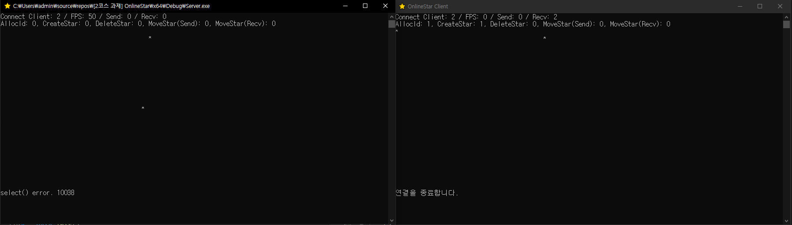
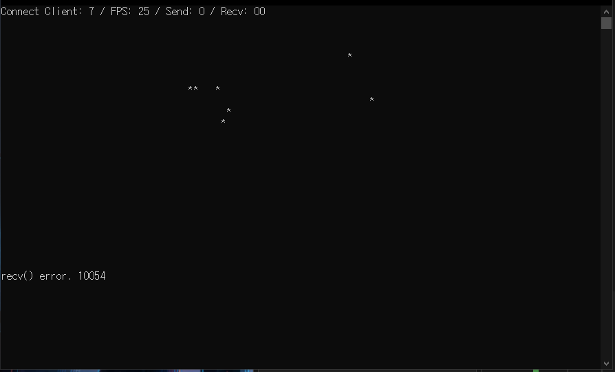
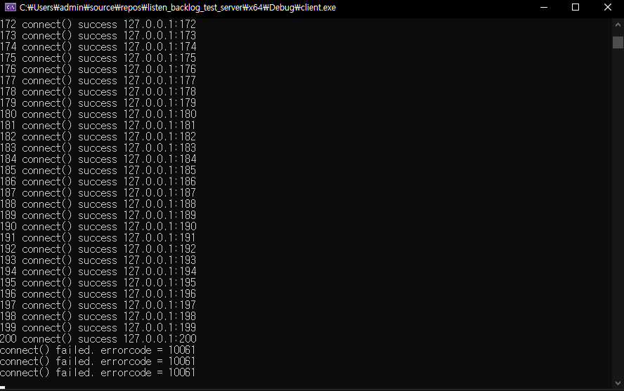
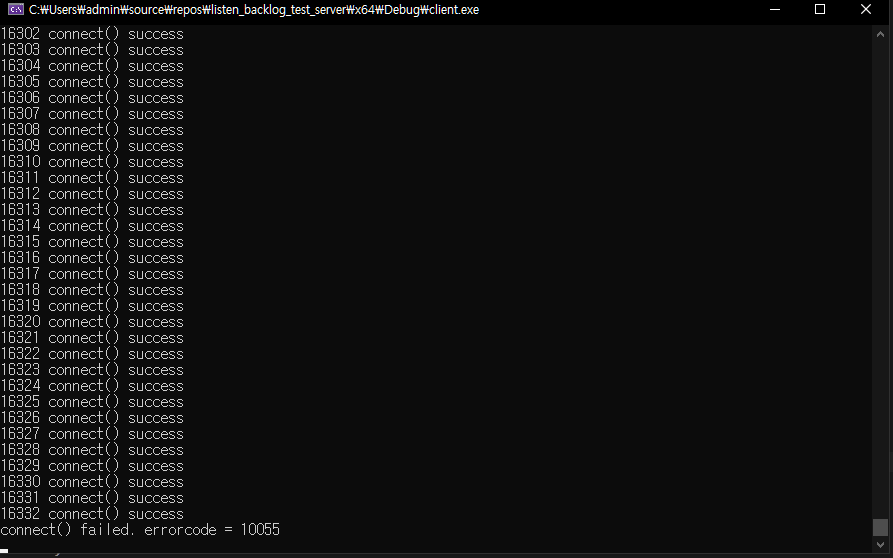
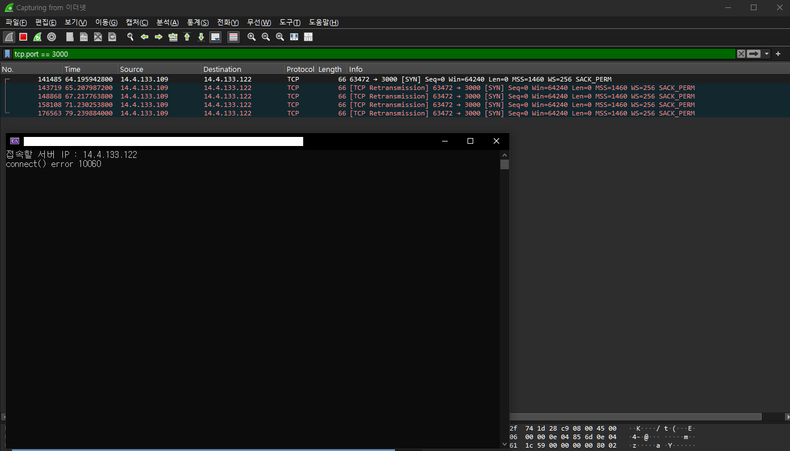
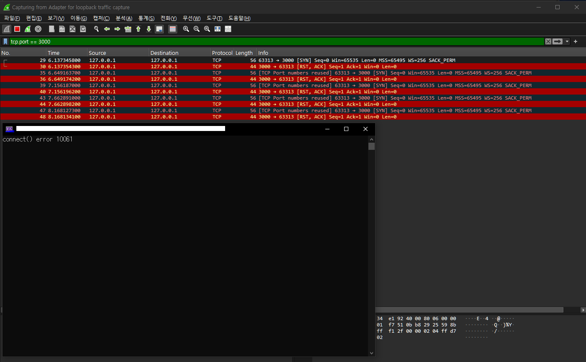

# Windows TCP Socket Error Log

실제 개발 및 테스트 과정에서 발견한 소켓 에러를 기록한다.

## 📝 기록 원칙

- 실제로 발생한 에러만 기록한다.
- Wireshark 패킷 캡처와 네트워크 이론을 바탕으로 원인을 분석한다.
- **가설 → 검증 → 결론** 과정을 거친다.
- 모든 기록은 Windows OS의 TCP 구현을 기준으로 한다.

---

## 📊 에러 코드 요약

| 코드 | 에러 이름 | 핵심 원인 |
|---:|---|---|
| [10038](#-wsaenotsock-10038) | `WSAENOTSOCK` | 소켓이 아닌항목에 대해 작업 |
| [10054](#-wsaeconnreset-10054) | `WSAECONNRESET` | 기존 연결의 강제 초기화 |
| [10055](#-wsaenobufs-10055) | `WSAENOBUFS` | 시스템 자원 고갈 |
| [10060](#️-wsaetimedout-10060) | `WSAETIMEDOUT` | 연결 응답 시간 초과 |
| [10061](#-wsaeconnrefused-10061) | `WSAECONNREFUSED` | 연결 요청 거부 |

---

## 🔌 WSAENOTSOCK (10038)
↩️ **[📊 에러 코드 요약으로 돌아가기](#-에러-코드-요약)**

* 소켓이 아닌 항목에 대한 작업.
* closesocket()한 소켓에대한 작업 -> 발견한 케이스에서는 이거였음

### 발생 상황

OnlineStar 과제중 서버 테스트중에 발생하였다.

1. 첫번째 클라가 접속후 종료했음.
2. 첫번째 클라의 별이 사라져야하는데 그에대한 처리 코드를 까먹고 작성하지 않았는지 별이 사라지지 않았음.
3. 그냥 무시하고 이어서 두번째클라를 켜서 접속해봤는데 서버쪽에서는 select()가 10038을 반환하였고, 클라쪽에서는 연결을 종료합니다. 라고 나왔음.



### 원인 분석

1. 첫번째 클라가 접속 종료하면서 TCP연결이 소멸되었음. 
2. 하지만 서버 L7단에 Session 정보가 지워지지 않았음. 마킹만하고 지우는 코드를 까먹고 작성하지 않았기 때문임. [★해당 Session에 소켓애 대해 closesocket()은 진행하였음★]
3. 그상태로 두번째 클라가 접속. 
4. 두번째 클라의 접속 과정에서. [두번째 클라의 별 정보 -> 첫번째 클라] 처리를 수행하면서 send().
5. 연결 종료된 소켓에다가 send() 시도하면서 에러발생. -> 서버를 종료할 순 없으니 파일로 로그를 남기고 그대로 진행.
6. 다음프레임 select()에서 closesocket()된 소켓에다가 시도하면서 10038 WSAENOTSOCK을 반환하였음.
7. 클라이언트는 FIN을 받고 recv()쪽에서 0을 반환하며 "연결을 종료합니다." 출력함. (왜 FIN을 받지? 링거로 RST쏘게 했는데..)

### 결론

closesocket()한 소켓에 대해 select() 수행하다가 발생하였음.

---

## 🔴 WSAECONNRESET (10054)
↩️ **[📊 에러 코드 요약으로 돌아가기](#-에러-코드-요약)**

원격 호스트에 의해 기존 연결이 강제로 초기화됨.

### 발생 상황

OnlineStar 과제 진행 중 서버와 클라이언트를 연결한 상태에서 서버를 먼저 종료했다.

이후 클라이언트의 `recv()`에서 `10054`가 반환되었다.




### 원인 분석

서버 프로세스 종료 과정에서 TCP 연결이 RST로 종료되었고, 클라이언트가 이를 수신한 것으로 판단했다.

### 결론

원격 호스트로부터 RST 패킷을 수신하여 기존 TCP 연결이 초기화된 경우 발생했다.

---

## 💾 WSAENOBUFS (10055)
↩️ **[📊 에러 코드 요약으로 돌아가기](#-에러-코드-요약)**

사용 가능한 버퍼 공간이 부족함. 버퍼뿐 아니라 시스템 네트워크 자원 부족으로도 발생할 수 있다.

### 발생 상황

Backlog Test 과제 중 발생하였다.

서버 측에서 `listen()` 호출 이후 `Sleep(INFINITE)`로 대기하고, 클라이언트는 소켓을 계속 생성하여 `connect()`를 시도했다.

- `SOMAXCONN` 사용 시: 약 200개 연결 이후 `WSAECONNREFUSED(10061)` 반환
- `SOMAXCONN_HINT(65535)` 사용 시: 클라이언트의 동적 포트 약 16,384개가 소진될 때까지 연결 시도 가능
- 이후 `WSAENOBUFS(10055)` 반환




### 원인 분석

클라이언트에서 사용할 수 있는 동적 포트 자원이 고갈된 것으로 판단했다.

더 이상 새로운 연결에 사용할 로컬 포트를 할당할 수 없게 되면서 `WSAENOBUFS(10055)`가 반환된 것으로 추정했다.

### 결론

소켓 통신에 필요한 버퍼 또는 시스템 네트워크 자원이 부족할 때 발생할 수 있는 오류다.

이번 실험에서는 클라이언트의 동적 포트 자원 고갈이 원인인 것으로 판단했다.

### 관찰한 네트워크 이론

- Backlog Queue (연결 대기 큐)
- TCP 동적 포트 (Ephemeral Port)
- 네트워크 시스템 자원 고갈

---

## ⏱️ WSAETIMEDOUT (10060)
↩️ **[📊 에러 코드 요약으로 돌아가기](#-에러-코드-요약)**

연결 요청에 대한 응답이 없어 연결 시도 시간이 초과됨. 
 
### 발생 상황

공유기의 포트포워딩을 설정하지 않은 상태에서 공인 IP의 3000번 포트로 `connect()`를 수행했다.

Wireshark에서 다음과 같은 SYN 재전송을 관찰했다.

| 시도 | 동작 | 대기 시간 |
|:---:|---|---:|
| 1 | SYN 전송 | 1초 |
| 2 | SYN 재전송 | 2초 |
| 3 | SYN 재전송 | 4초 |
| 4 | SYN 재전송 | 8초 |
| 5 | SYN 재전송 | 5초 |

최종적으로 20초간 연결시도 후 `connect()`에서 `10060`이 반환되었다.



### 원인 분석

포트포워딩이 설정되지 않아 공유기에서 내부 서버로 연결이 전달되지 않은 것으로 추정했다.

응답을 받지 못한 클라이언트는 SYN을 재전송하며 연결을 시도했고, 최종적으로 연결 시도 시간이 초과되었다.

### 결론

SYN에 대한 응답을 받지 못해 TCP 연결 수립이 실패한 경우 발생했다.

### 관찰한 네트워크 이론

- TCP SYN 재전송
- RTO (Retransmission Timeout)
- 지수형 백오프 (Exponential Backoff)

---

## 🚫 WSAECONNREFUSED (10061)
↩️ **[📊 에러 코드 요약으로 돌아가기](#-에러-코드-요약)**

대상 호스트가 연결 요청을 명시적으로 거부함. 

### 발생 상황

서버 프로그램을 실행하지 않은 상태에서 `127.0.0.1:3000`으로 `connect()`를 수행했다.

Wireshark에서 다음 패킷 흐름을 관찰했다.

```text
(SYN -> RST) * 5회 반복
```

최종적으로 `connect()`에서 `10061`이 반환되었다.



### 원인 분석

루프백 주소를 통해 로컬 TCP/IP 스택까지 연결 요청이 전달되었다.

하지만 3000번 포트에서 LISTEN 중인 서버 소켓이 없었기 때문에 RST 패킷으로 응답한 것으로 판단했다.

### 결론

패킷이 성공적으로 도착하였지만, 대상 포트에서 연결을 받아줄 서버가 없어 RST 응답을 보냈다.

---

*실제 관찰을 통해 확인한 내용을 지속적으로 추가할 예정.*
